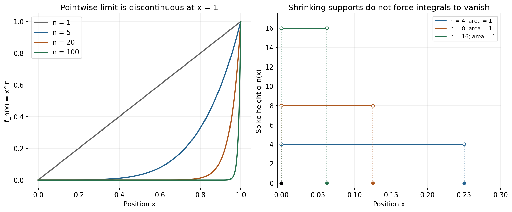
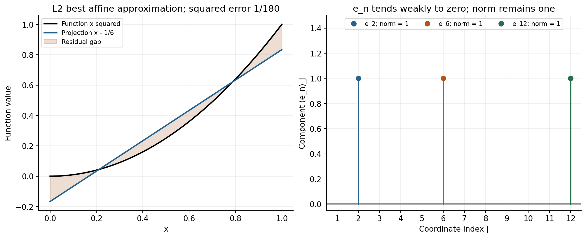

# Spaces and convergence: what does it mean to get close?

**Lesson ID:** LES-ADV-003  
**Level:** University analysis and linear algebra bridge.  
**Prerequisites:** Limits, integrals, vectors, inner products and basic infinite series. Use [functions, limits and series](../../subjects/analysis/functions-limits-and-series.md) and [functional analysis](../../subjects/functional-analysis/functional-analysis.md) as references.  
**Objectives:** Distinguish numerical, pointwise, uniform, norm and weak convergence; prove a uniform-limit result; construct counterexamples to exchanging limits; derive an $L^2$ projection; explain completeness and weak convergence in $\ell^2$.  
**Status:** Written guided lesson; learner mastery remains unassessed.

The phrase “the approximations converge” is incomplete until the space and meaning of closeness are specified. A curve can be close in integrated error yet have a large pointwise peak. An infinite vector can approach zero under every fixed continuous linear measurement while keeping norm one. These are precise mathematical possibilities, not defects in terminology. They explain why an engineering calculation must identify the error quantity it controls.

Throughout this book the complex inner product is conjugate-linear in its first argument and linear in its second. Thus $\langle u,v\rangle=\sum_j\overline{u_j}v_j$ for finite vectors and $\langle f,g\rangle=\int\overline f g$ for functions when the integral exists. The calculations below mostly use real functions, but the coefficient order remains consistent with that convention.

## Stage 1: read the quantifiers before looking at a graph

A numerical sequence $a_n$ tends to $a$ if for every $\varepsilon>0$ there exists $N$ such that $n\ge N$ implies $|a_n-a|<\varepsilon$. A sequence of functions $f_n:D\to\mathbb R$ has more than one possible convergence rule.

**Pointwise convergence** to $f$ means that for every fixed $x\in D$ and every $\varepsilon>0$ there is a threshold $N(x,\varepsilon)$ after which $|f_n(x)-f(x)|<\varepsilon$. **Uniform convergence** reverses the important order: for every $\varepsilon>0$ there is one $N(\varepsilon)$ such that the inequality holds for every $x\in D$ whenever $n\ge N$. The uniform threshold cannot depend on position.

When the supremum is finite, uniform convergence is equivalent to $\|f_n-f\|_\infty=\sup_{x\in D}|f_n(x)-f(x)|\to0$. This norm asks about the largest error over the whole domain, including narrow regions a coarse graph might miss.

**Worked example 1: a boundary layer in $x^n$.** On $[0,1]$, let $f_n(x)=x^n$. For $0\le x<1$, repeated multiplication by a number below one gives $x^n\to0$. At $x=1$, the value is always one. The pointwise limit is therefore $f(x)=0$ for $x<1$ and $f(1)=1$.

Uniform convergence fails. For every $n$, points sufficiently close to one from below have $x^n$ arbitrarily close to one, while $f(x)=0$ at those points. Consequently $\sup|f_n-f|=1$, even though that supremum is not attained at a point below one. A maximum and a supremum are different concepts here.

Restricting the domain changes the conclusion. On $[0,q]$ with fixed $0<q<1$, $\sup x^n=q^n\to0$, so convergence to zero is uniform. For $0<\varepsilon<1$, any integer $N>\ln\varepsilon/\ln q$ makes $q^N<\varepsilon$. This formula explicitly supplies one threshold for the entire smaller interval.

**Why uniform limits preserve continuity.** Suppose every $f_n$ is continuous on $D$ and $f_n\to f$ uniformly. Fix $a\in D$ and $\varepsilon>0$. Choose one index $n$ for which $|f_n-f|<\varepsilon/3$ everywhere. Continuity of this fixed $f_n$ provides a neighborhood of $a$ where $|f_n(x)-f_n(a)|<\varepsilon/3$. The triangle inequality gives

$$|f(x)-f(a)|\le|f(x)-f_n(x)|+|f_n(x)-f_n(a)|+|f_n(a)-f(a)|<\varepsilon.$$

Thus $f$ is continuous. In the example, the discontinuous pointwise limit is another rigorous reason uniform convergence is impossible. The proof identifies exactly where the common threshold is needed.

## Stage 2: distinguish peak, area and squared-area error

For measurable functions on $[0,1]$, define $\|f\|_1=\int_0^1|f|$ and $\|f\|_2=(\int_0^1|f|^2)^{1/2}$. The spaces $L^1$ and $L^2$ identify functions equal almost everywhere: changing a value at one point does not change the element or either integral norm. A pointwise graph represents a particular function, while an $L^2$ element is an equivalence class.

The same powers from stage 1 satisfy

$$\|x^n\|_2^2=\int_0^1x^{2n}\,dx=\frac1{2n+1}\longrightarrow0.$$

Thus $f_n\to0$ in $L^2$ even though the pointwise limit equals one at the endpoint. There is no contradiction: that pointwise limit equals zero almost everywhere and represents the zero $L^2$ element. This is a useful test of whether the difference between functions and equivalence classes is understood.

**Worked example 2: disappearing support can hide persistent area.** Set $g_n(x)=n$ on $0<x<1/n$ and zero elsewhere, including at zero. Every fixed $x>0$ eventually lies outside the support, and $g_n(0)=0$, so $g_n\to0$ pointwise everywhere. Yet

$$\int_0^1g_n(x)\,dx=1,\qquad\|g_n\|_2^2=n.$$

Moving the limit through the integral would incorrectly give $1=0$. The support shrinks, but the height grows fast enough to preserve area. Pointwise convergence alone does not justify exchanging an integral and limit. A dominated-convergence theorem needs an integrable common dominating function; none exists for this family, since otherwise its conclusion would contradict the calculation.

For a less severe variant, set $h_n=\sqrt n$ on the same open interval and zero elsewhere. Then $\|h_n\|_1=1/\sqrt n\to0$, but $\|h_n\|_2=1$. Thus even convergence in $L^1$ does not imply convergence in $L^2$ on this finite interval. In the other direction, Cauchy–Schwarz gives $\|u\|_1\le\|u\|_2$ on $[0,1]$, so $L^2$ convergence does imply $L^1$ convergence here.

Uniform convergence is stronger than these integral statements on a finite interval: $\|u\|_2\le\|u\|_\infty$ on $[0,1]$. The domain's measure appears as a square-root factor on other finite-measure domains. On an infinite-measure domain, a uniform error bound need not give a finite integral norm at all.

## Stage 3: derive an approximation as an orthogonal projection

**Worked example 3: fit a line to an entire function.** Approximate $f(x)=x^2$ on $[0,1]$ by $p(x)=a+bx$, minimizing integrated squared error

$$J(a,b)=\int_0^1[x^2-a-bx]^2\,dx.$$

This is not interpolation through selected points. Differentiation with respect to $a$ and $b$ gives residual orthogonality to the available basis functions:

$$\int_0^1(x^2-a-bx)\,dx=0,\qquad
\int_0^1x(x^2-a-bx)\,dx=0.$$

Equivalently,

$$\begin{pmatrix}1&1/2\\1/2&1/3\end{pmatrix}
\begin{pmatrix}a\\b\end{pmatrix}
=\begin{pmatrix}1/3\\1/4\end{pmatrix}.$$

The Gram matrix is positive definite: its leading entry is positive and determinant is $1/12>0$. Thus the quadratic minimization has one solution, $a=-1/6$ and $b=1$. The residual is $r=x^2-x+1/6$, and direct integration gives $\int r=\int xr=0$ and $\|r\|_2^2=1/180$.

To prove minimality independently, let any other affine function be $p+v$, where $v$ is also affine. Then $\langle r,v\rangle=0$, so

$$\|f-(p+v)\|_2^2=\|r-v\|_2^2=\|r\|_2^2+\|v\|_2^2\ge\|r\|_2^2.$$

Equality requires $v=0$ in $L^2$; since $v$ is continuous, it is then identically zero. The projection therefore uniquely minimizes the error. Its worst pointwise error is $1/6$, attained at the endpoints, whereas the $L^2$ error is $1/\sqrt{180}$. Reporting the latter as a uniform bound would be wrong.

For an orthonormal basis $e_j$ and our inner-product convention, the finite projection is $P_Nf=\sum_{j=1}^N\langle e_j,f\rangle e_j$. The coefficient order matters for complex functions. For a nonorthogonal basis, the Gram system replaces these independent coefficient formulas. This is the geometry behind least squares, spectral approximations and many finite-element equations.

## Stage 4: ask whether a Cauchy approximation has a home

A sequence is **Cauchy** in a norm if for every $\varepsilon>0$ there is $N$ such that $\|x_m-x_n\|<\varepsilon$ for all $m,n\ge N$. This definition compares approximations with one another without naming a limit. A normed space is **complete** if every such sequence has a limit in the same space.

Completeness depends on both the objects and the norm. Continuous functions on $[0,1]$ are complete in the supremum norm, because a uniformly Cauchy sequence has a pointwise real limit, converges uniformly to it, and the previous continuity theorem keeps that limit continuous. The same collection of continuous functions is not complete in the $L^2$ norm.

**Worked example 4: continuous ramps approach a discontinuity in $L^2$.** For integers $n\ge2$, define $u_n=0$ on $[0,1/2]$, $u_n=n(x-1/2)$ on $[1/2,1/2+1/n]$, and $u_n=1$ to the right. These continuous functions approach the step $u=0$ on $x\le1/2$ and $u=1$ on $x>1/2$. Only the ramp interval contributes to the error, so

$$\|u_n-u\|_2^2=\int_0^{1/n}(1-ns)^2ds=\frac1{3n}.$$

The triangle inequality makes $(u_n)$ Cauchy in $L^2$. No continuous function can equal the limiting step almost everywhere: continuity would force it to be zero throughout the left open half and one throughout the right open half, giving incompatible one-sided values at the midpoint. Completing the space requires allowing appropriate measurable equivalence classes. The theorem that $L^2$ is complete is a foundational result, not a consequence of plotting these particular ramps.

The sequence space $\ell^2=\{x:\sum_j|x_j|^2<\infty\}$ has norm $\|x\|_2=(\sum_j|x_j|^2)^{1/2}$ and is also complete. A short proof reveals the role of all coordinates. If $x^{(n)}$ is Cauchy, each coordinate is a Cauchy scalar sequence because $|x_j^{(m)}-x_j^{(n)}|\le\|x^{(m)}-x^{(n)}\|_2$. Define its scalar limit $x_j$. For $m,n\ge N$ the squared norm difference is at most $\varepsilon^2$. First keep only finitely many coordinates and let $m\to\infty$; the finite sum of $|x_j-x_j^{(n)}|^2$ is still at most $\varepsilon^2$. Taking the supremum over finite initial sums shows $x-x^{(n)}\in\ell^2$ with norm at most $\varepsilon$. Since one $x^{(n)}$ already lies in $\ell^2$, so does $x$, and convergence follows. This proves completeness without assuming coordinatewise convergence alone is sufficient.

## Stage 5: understand a weaker but useful convergence

**Worked example 5: the moving coordinate vector.** Let $e_n$ have one in coordinate $n$ and zeros elsewhere. Its norm is always one, so $e_n$ does not converge to zero in norm. Distinct vectors have distance $\sqrt2$, so there is not even a norm-Cauchy subsequence.

However, for every fixed $y\in\ell^2$,

$$\langle y,e_n\rangle=\overline{y_n}\longrightarrow0,$$

because square-summability forces $y_n\to0$. Every bounded linear functional on a Hilbert space has the form $\ell_y(x)=\langle y,x\rangle$ by Riesz representation. Thus every fixed continuous linear measurement of $e_n$ tends to zero: this is **weak convergence**, written $e_n\rightharpoonup0$. The norm itself is not a linear functional, so its constant value does not contradict that definition.

Coordinatewise convergence by itself is weaker still. The vectors $z_n=ne_n$ have every fixed coordinate eventually zero, but they are not weakly zero. Choose the fixed vector $y=(1,1/2,1/3,\ldots)\in\ell^2$; then $\langle y,z_n\rangle=1$ for every $n$. A quantifier over every fixed functional can detect behavior that checking one coordinate at a time misses. Weak convergence is useful in existence proofs precisely because it can retain enough linear information when strong compactness fails; it does not promise small pointwise or energy error.

## Practice problems

1. Does $f_n(x)=x/n$ converge uniformly to zero on $[0,1]$? What about on $\mathbb R$?
2. Calculate the $L^1$ and $L^2$ norms of $x^n$ on $[0,1]$.
3. For $g_n=n$ on $(0,1/n)$ and zero elsewhere, compute its supremum norm and explain why it does not converge in $L^1$ to zero.
4. Find the best constant approximation to $x^2$ in $L^2[0,1]$ and its squared error.
5. Prove that $\|f\|_1\le\sqrt{b-a}\|f\|_2$ on a finite interval $[a,b]$.
6. Let $s^{(N)}=(1,1/2,\ldots,1/N,0,\ldots)$. Show it converges in $\ell^2$ and bound its squared error by $1/N$.
7. Prove that norm convergence in a normed space implies weak convergence.
8. In complex $\mathbb C^2$, take unit vector $e=(1,i)/\sqrt2$ and $x=(1,0)$. Compute $\langle e,x\rangle e$ and verify residual orthogonality using the book's convention.

## Answers and explanations

1. On $[0,1]$ the supremum error is $1/n$, hence uniform convergence. On $\mathbb R$, for every $n$ the function is unbounded and no common accuracy bound holds over all inputs, although each fixed input tends to zero.
2. The $L^1$ norm is $1/(n+1)$ and the $L^2$ norm is $1/\sqrt{2n+1}$. Both vanish, even though the functions' supremum norm is always one.
3. The supremum norm is $n$. The $L^1$ norm is area $n(1/n)=1$, so the distance from zero never decreases in that norm despite pointwise convergence.
4. Orthogonality to $1$ gives $c=\int_0^1x^2dx=1/3$. The squared error is $\int(x^2-1/3)^2=1/5-1/9=4/45$. A best constant leaves more error than the two-dimensional affine space's $1/180$, as expected.
5. Apply Cauchy–Schwarz to $|f|$ and the constant function one: $\int|f|\le(\int|f|^2)^{1/2}(\int1)^{1/2}$. The second factor is $\sqrt{b-a}$.
6. The limit is $s=(1,1/2,1/3,\ldots)$, which lies in $\ell^2$ because $\sum1/j^2$ converges. Its squared error is $\sum_{j>N}1/j^2\le\int_N^\infty x^{-2}dx=1/N$.
7. For a bounded functional $\ell$, $|\ell(x_n)-\ell(x)|\le\|\ell\|\|x_n-x\|\to0$. This works for every fixed bounded linear functional, exactly the definition of weak convergence.
8. $\langle e,x\rangle=1/\sqrt2$, so the projection is $(1,i)/2$. The residual is $(1,-i)/2$. Taking the inner product with $e$ gives $(1+(-i)(-i))/(2\sqrt2)=0$. Reversing the coefficient's arguments would be wrong for general complex data.

## Verification and further study

[plot_lessons_advanced.py](../../scripts/plot_lessons_advanced.py) reproduces both figures. [verify_lessons_advanced.py](../../scripts/verify_lessons_advanced.py) checks exact norms, orthogonality, Gram determinants, ramp errors and the complex projection. The examples supplement, rather than prove, the general $L^2$ completeness and Riesz representation theorems. See Jiří Lebl's [*Basic Analysis*](https://www.jirka.org/ra/) for uniform convergence and the MIT [18.102 functional-analysis notes](https://ocw.mit.edu/courses/18-102-introduction-to-functional-analysis-spring-2021/pages/lecture-notes-and-readings/) for Hilbert-space foundations. Before recording mastery, explain in one paragraph how $x^n$ can converge in $L^2$ while failing to converge uniformly on the same interval.
