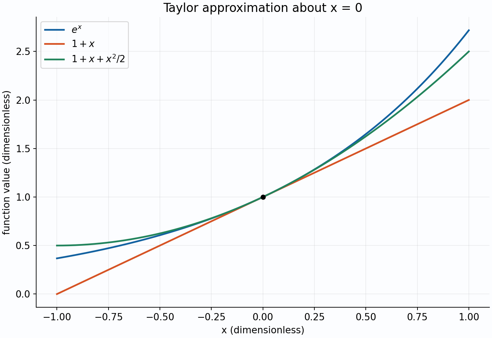

# Differential and integral calculus

**Topic ID:** CAL-01.  
**Classification:** Analysis → single-variable calculus.  
**Level:** Beginning undergraduate.  
**Content status:** Written compact reference chapter.  
**Learner mastery:** Unassessed.

## Prerequisites

Know functions, limits, algebra, radians, exponentials, and logarithms. Diagnostic: $(x+h)^2-x^2=2xh+h^2$, so its quotient by $h\ne0$ tends to $2x$ as $h\to0$. Calculus uses this limiting process to distinguish an instantaneous rate from an average rate. The [subject map](../../CONTENTS.md) locates the elementary prerequisites and convergence theory.

## Definition

For a real function $f$ on an open interval, its **derivative** at $a$ is

$$f'(a)=\lim_{h\to0}\frac{f(a+h)-f(a)}h,$$

when that finite two-sided limit exists. At a domain endpoint only an appropriate one-sided derivative is available. A **Riemann integral** is the common limit of tagged sums $\sum_i f(\xi_i)\Delta x_i$ as the largest subinterval length tends to zero, independent of tags and partitions. A bounded continuous function on a closed interval is Riemann integrable. An antiderivative $F$ satisfies $F'=f$; a definite integral is a number, while an antiderivative is a function.

## Intuitive explanation

A derivative is the coefficient of the best local linear approximation: $f(a+h)=f(a)+f'(a)h+o(h)$. An integral accumulates small contributions. If velocity is in m/s and time in seconds, its integral is displacement in metres, while the integral of speed is total distance. Negative signed area is meaningful; replacing $f$ by $|f|$ answers a different question. The fundamental theorem connects accumulation to rate when continuity supplies the needed limit.

Exact curves: $e^x$, $1+x$, and $1+x+x^2/2$, on $-1\le x\le1$. Both axes are dimensionless. The approximation is local, and its error is bounded below in the theorem section.

## Mathematical notation

$f^{(n)}$ denotes the $n$th derivative; $dx$ indicates the integration variable. Write $[F(x)]_a^b=F(b)-F(a)$. A prime means differentiation with respect to the displayed independent variable, unless a parameter is explicitly declared. Angles in differentiation formulas are radians. A logarithm of a physical ratio uses compatible units, such as $\log(L/L_0)$, so its argument is dimensionless.

## Fundamental properties

Differentiability implies continuity, although the converse fails: $|x|$ is continuous but not differentiable at zero. Product and chain rules give $(fg)'=f'g+fg'$ and $(f\circ g)'=(f'\circ g)g'$. The quotient rule requires a nonzero denominator. Implicit differentiation of $F(x,y(x))=0$ gives $y'=-F_x/F_y$ where $F_y\ne0$ and a differentiable local solution exists.

**Mean value theorem, cited without full proof.** If $f$ is continuous on $[a,b]$ and differentiable on $(a,b)$, some $c\in(a,b)$ satisfies $f'(c)=[f(b)-f(a)]/(b-a)$. It yields monotonicity tests and error bounds; it is not valid across a jump or a missing domain point.

**Taylor theorem, cited with its precise remainder.** If $f$ has $n+1$ continuous derivatives on the interval joining $a$ and $x$, then

$$f(x)=\sum_{k=0}^{n}\frac{f^{(k)}(a)}{k!}(x-a)^k+\frac{f^{(n+1)}(\xi)}{(n+1)!}(x-a)^{n+1}$$

for some intermediate $\xi$. Thus a bound $|f^{(n+1)}|\le M$ gives an error at most $M|x-a|^{n+1}/(n+1)!$. A Taylor series need not equal a smooth function without a separate remainder argument.

## Important formulas and identities

For continuous $f$, the fundamental theorem states

$$\frac{d}{dx}\int_a^x f(t)\,dt=f(x),\qquad \int_a^b F'(x)\,dx=F(b)-F(a).$$

Substitution follows the chain rule: $\int_a^b f(g(x))g'(x)\,dx=\int_{g(a)}^{g(b)}f(u)\,du$ for continuously differentiable $g$ and continuous $f$ on its image. Integration by parts is $\int_a^b u v'=[uv]_a^b-\int_a^b u'v$. Rational integration first divides improper fractions, factors the denominator over the reals, and uses partial fractions. Trigonometric integrals use identities or substitutions such as $x=a\sin\theta$ for $\sqrt{a^2-x^2}$, with a declared interval ensuring the square-root sign.

For a smooth regular parameterized curve $(x(t),y(t))$,

$$\frac{dy}{dx}=\frac{y'(t)}{x'(t)}\quad(x'\ne0),\qquad L=\int_\alpha^\beta\sqrt{x'^2+y'^2}\,dt.$$

For a polar curve $r=r(\theta)$, $x=r\cos\theta$, $y=r\sin\theta$,

$$\frac{dy}{dx}=\frac{r'\sin\theta+r\cos\theta}{r'\cos\theta-r\sin\theta},\qquad A=\frac12\int_\alpha^\beta r(\theta)^2\,d\theta.$$

The slope formula requires $r'\cos\theta-r\sin\theta\ne0$. The area formula counts swept area; determine whether the curve retraces a region before interpreting it as its geometric area. A volume of revolution by disks is $V=\pi\int_a^bR(x)^2dx$, with subtraction of an inner radius for washers.

## Derivations and proofs

**First fundamental theorem.** Let $G(x)=\int_a^x f(t)dt$ with $f$ continuous. For $h>0$,

$$\frac{G(x+h)-G(x)}h-f(x)=\frac1h\int_x^{x+h}[f(t)-f(x)]dt.$$

Its absolute value is at most $\sup_{t\in[x,x+h]}|f(t)-f(x)|$, which tends to zero by continuity. Reversing the interval proves the same for $h<0$. Therefore $G'=f$. If $F'=f$, then $(F-G)'=0$; the mean value theorem makes $F-G$ constant, yielding the second formula.

For an **improper integral**, the endpoint limit is part of the definition: $\int_1^\infty f=\lim_{R\to\infty}\int_1^R f$. For $p\ne1$, integrating $x^{-p}$ gives $(R^{1-p}-1)/(1-p)$. The limit is finite exactly when $p>1$, with value $1/(p-1)$. For $p=1$, $\log R$ diverges. Near zero, $\int_0^1x^{-p}dx$ instead converges exactly when $p<1$. If there is an interior singularity, each side must converge separately; symmetric cancellation alone is a principal value, not an ordinary improper integral.

## Worked examples

**1. Curve sketching and extrema.** For $f(x)=x^3-3x$, calculate $f'=3(x^2-1)$ and $f''=6x$. The critical points are $-1,1$. The derivative changes from positive to negative at $-1$, giving a local maximum $2$, and from negative to positive at $1$, giving a local minimum $-2$. The concavity changes at $(0,0)$. On $[-2,2]$, check endpoints as well: $f(-2)=-2$, $f(2)=2$, so the extrema are attained more than once. Critical-point equations alone would miss the endpoints.

**2. A nontrivial integral.** Evaluate $\int_0^1x\log(1+x)dx$. Choose $u=\log(1+x)$, $dv=x\,dx$. Integration by parts gives

$$\frac12\log2-\frac12\int_0^1\frac{x^2}{1+x}dx.$$

Polynomial division gives $x^2/(1+x)=x-1+1/(1+x)$. The last integral is $\log2-1/2$, leaving $1/4$. Differentiating the intermediate antiderivative, or positive numerical quadrature, checks the result. Choosing substitution alone does not remove every term, whereas parts uses the simple derivative of the logarithm.

**3. Related rates with units.** A sphere has radius $r=2$ m growing at $dr/dt=3/100$ m/s. With $V=4\pi r^3/3$, the chain rule gives $dV/dt=4\pi r^2dr/dt=12\pi/25$ m³/s. Do not insert $r=2$ before differentiating: that would replace a changing quantity by a constant. The factor $4\pi r^2$ has units m², verifying the result's dimensions.

**4. Polar area.** For $r=1+\cos\theta$, $0\le\theta\le2\pi$, the cardioid is traced once apart from the shared endpoint. Hence $A=\tfrac12\int_0^{2\pi}(1+2\cos\theta+\cos^2\theta)d\theta=3\pi/2$. The cosine term averages to zero and the cosine-square term integrates to $\pi$; the nonnegative radius and symmetry help check the geometry.

**5. Parametric arc length.** For the parabola parameterization $x=t$, $y=t^2/2$, $0\le t\le1$, the speed is $\sqrt{1+t^2}$, so the length is $\int_0^1\sqrt{1+t^2}dt$. Use $t=\sinh u$, or verify by differentiation the antiderivative $(t\sqrt{1+t^2}+\log(t+\sqrt{1+t^2}))/2$. The result is $(\sqrt2+\log(1+\sqrt2))/2$. It exceeds the endpoint chord length $\sqrt5/2$, as geometry requires. The integral uses speed along the curve, not its vertical change. If coordinates have length unit metres and the parameter is dimensionless, the final length is in metres.

## Practice problems

1. Differentiate $\log(1+x^2)$ for real $x$.
2. Evaluate $\int_0^1 2x e^{x^2}dx$ exactly.
3. Approximate $e^{1/10}$ using the quadratic Taylor polynomial, with an explicit error bound.
4. Does $\int_{-1}^1(1/x)dx$ exist as an ordinary improper integral?

## Answers and explanations

1. The inner derivative is $2x$, giving $2x/(1+x^2)$. The argument is positive for all real $x$.
2. Set $u=x^2$, $du=2x dx$; the new bounds are $0,1$. The value is $e-1$.
3. The polynomial gives $1+1/10+1/200=221/200$. Since $e^\xi\le e^{1/10}$, the error is at most $e^{1/10}/6000<1/5000$; the latter follows, for example, from $e^{1/10}<6/5$. It is an approximation, not an equality.
4. No. The left and right integrals diverge to opposite infinities. Its symmetric principal value is zero, which is a different limiting convention.

## Common mistakes and misconceptions

A derivative of zero at a point does not imply an extremum: $x^3$ at zero is the standard counterexample. An indefinite integral needs a constant on each connected domain interval. Cancelling a factor can remove a domain restriction only after it has been recorded. L'Hôpital's rule requires an appropriate indeterminate form and derivative hypotheses; it is not a universal rule for quotients. A vertical tangent is not represented by a finite $dy/dx$.

## Connections to other mathematics

The [real analysis chapter](../analysis/real-analysis-and-measure.md) explains the limits behind these operations. The [multivariable chapter](multivariable-and-vector-calculus.md) replaces a derivative by a linear map. [Differential equations](../differential-equations/ordinary-differential-equations.md) reverse rate calculations to recover evolving quantities.

## Applications

Work along a one-dimensional path is $W=\int_a^bF(x)dx$. For an ideal spring with stiffness $k=200$ N/m extended quasistatically from $0$ to $1/10$ m, $W=kx^2/2=1$ J. The model assumes a linear force law and neglects dissipation. Sensitivity uses $\Delta f\approx f'\Delta x$; relative sensitivity is $xf'/f$ where $f\ne0$, which clarifies why a small input error can cause a large relative output error near a zero.

## Optional computational examples

[plot_analysis.py](../../scripts/plot_analysis.py) generates the exact Taylor curves. [verify_analysis.py](../../scripts/verify_analysis.py) differentiates antiderivatives and checks examples and exercises using exact symbolic arithmetic. Sampled curves illustrate behavior; they cannot establish differentiability at an unsampled point.

## References and recommended reading

Sources and further study: Gilbert Strang and Edwin Herman, OpenStax [Calculus Volume 1](https://openstax.org/details/books/calculus-volume-1), derivatives, applications, and integration; [Calculus Volume 2](https://openstax.org/details/books/calculus-volume-2), integration techniques, parametric equations, and polar coordinates. This chapter's wording and examples are original.

## Revision and mastery status

Written 2026-10-18. This compact chapter covers the group 08 methods but does not replace a full exercise-based calculus course. Mastery requires justifying a derivative, selecting an integration method, bounding a Taylor error, and checking an improper integral's defining limits. Learner assessment remains open.
